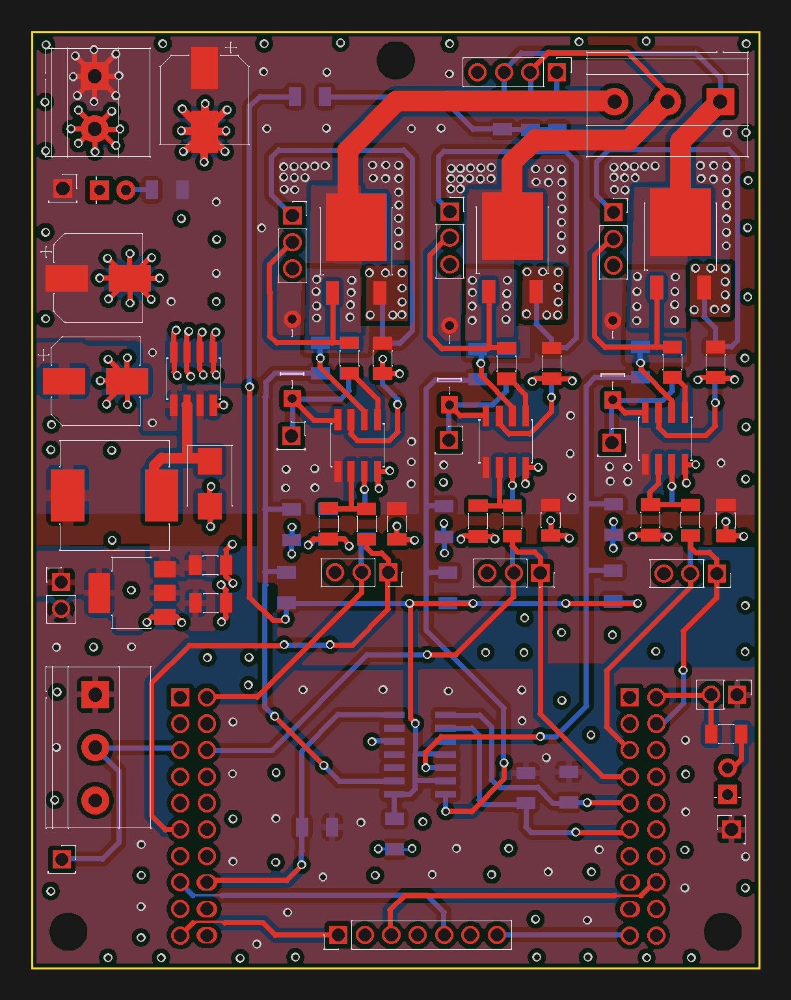

# Controlador de motor BLDC (ESC sensorless) — PCB en KiCad

Placa de potencia y acondicionamiento para controlar un motor BLDC trifásico sin sensores Hall desde una LaunchPad **TI Tiva C TM4C123GXL**. Integra el inversor trifásico con sus drivers, la detección de cruces por cero de la fuerza contraelectromotriz (BEMF) para conmutación sensorless y la alimentación de toda la placa a partir de una única entrada de 12 V.

Proyecto de la asignatura *Laboratori de Sistemes Electrònics I* (Grado en Ingeniería Electrónica de Telecomunicación, Universitat de Barcelona).



## Características

| | |
|---|---|
| Herramienta | KiCad 9 |
| Dimensiones | 70 × 90 mm, 2 taladros M3 |
| Capas | 4 (F.Cu, In1.Cu, In2.Cu, B.Cu), 1,57 mm |
| Alimentación | 12 V (bus del motor y lógica) |
| Etapa de potencia | 6 × MOSFET canal N en DPAK (TO-252), tres semipuentes |
| Drivers | 3 × IR2301 (high/low side con bootstrap) |
| Detección BEMF | LM339 (comparador cuádruple) + neutro virtual resistivo |
| Reguladores | AP1509-50 (buck 12 V → 5 V) + LMS8117 (LDO 5 V → 3,3 V) |
| Controlador | Tiva C TM4C123GXL (se monta sobre los conectores J1–J4) |

## Descripción del circuito

El esquema es jerárquico. La hoja raíz agrupa cuatro bloques: **TM4C123GXL** (conectores de la LaunchPad), **Motor** (que contiene las subhojas *Drivers* y *Comparadores*), **IO** (alimentación, conectores y LEDs) y **Testpoints**.

**Etapa de potencia (`Drivers.kicad_sch`).** Cada fase es un semipuente de dos NMOS (MxH/MxL) alimentado desde el bus de 12 V. Un IR2301 por fase genera las tensiones de puerta: el lado alto se alimenta por bootstrap (diodo 1N4149 + condensador entre VB y la fase), cada puerta tiene su resistencia serie (RGxH/RGxL) y cada entrada lógica una resistencia (RIxH/RIxL) desde la Tiva. Las entradas de lado alto van a pines con salida PWM y las de lado bajo a GPIO.

**Detección de BEMF (`Comparadores.kicad_sch`).** Tres resistencias en estrella (RFA/RFB/RFC) reconstruyen el neutro virtual del motor. La tensión de cada fase y la del neutro pasan por divisores resistivos que las llevan a un rango compatible con la lógica de 3,3 V, y un LM339 compara cada fase flotante contra el neutro. Las salidas en colector abierto tienen pull-up a 3,3 V y entran a la Tiva como señales digitales de cruce por cero, que el firmware usa para temporizar la conmutación.

**Alimentación e IO (`IO.kicad_sch`).** La entrada de 12 V (bornera) alimenta directamente el bus de potencia y los drivers. Un buck AP1509-50 (bobina de 47 µH, diodo Schottky B220) genera 5 V y un LDO LMS8117 baja a 3,3 V. Dos jumpers permiten elegir de dónde sale el raíl de 3,3 V de la placa: del LDO (`FUENTE`) y/o del regulador de la propia Tiva (`TIVA`). Hay un LED indicador de 12 V y otro del 3,3 V de la Tiva, y una bornera de tres vías para las fases del motor.

**Test points (`Testpoints.kicad_sch`).** Acceso a las entradas lógicas de los drivers, las puertas de los seis MOSFET, los nodos de bootstrap, las tres fases, VCC, 3,3 V y el potenciómetro, pensado para depurar la placa con osciloscopio.

## Asignación de pines (TM4C123GXL)

| Señal | Pin Tiva | Función |
|---|---|---|
| Fase A alto / bajo | PB5 / PD0 | Entradas HIN / LIN del IR2301 A |
| Fase B alto / bajo | PD1 / PB3 | Entradas HIN / LIN del IR2301 B |
| Fase C alto / bajo | PB7 / PF2 | Entradas HIN / LIN del IR2301 C |
| BEMF A / B / C | PD2 / PD3 / PD6 | Salidas del LM339 |
| Potenciómetro | PE0 (AIN3) | Consigna analógica de velocidad |
| SPI | PA2 (SCLK), PA5 (MOSI), PA4 (MISO), PF1 (SS) | Conector de expansión |

## Estructura del repositorio

```
Control Motor BLDC.kicad_pro   Proyecto de KiCad
Control Motor BLDC.kicad_sch   Hoja raíz del esquema
Control Motor BLDC.kicad_pcb   Layout
*.kicad_sch                    Subhojas (Drivers, Comparadores, IO, Motor, TM4C123GXL, Testpoints)
Footprints/                    Símbolos y footprints propios (NMOS DPAK, AP1509, LDO)
docs/                          Imágenes del README
```

Las librerías propias se referencian con `${KIPRJMOD}` en `fp-lib-table` y `sym-lib-table`, así que el proyecto abre sin configuración adicional en KiCad 9 o posterior.

## Autor

Manuel Argibay Molina — [@ManuelArgibay](https://github.com/ManuelArgibay)
